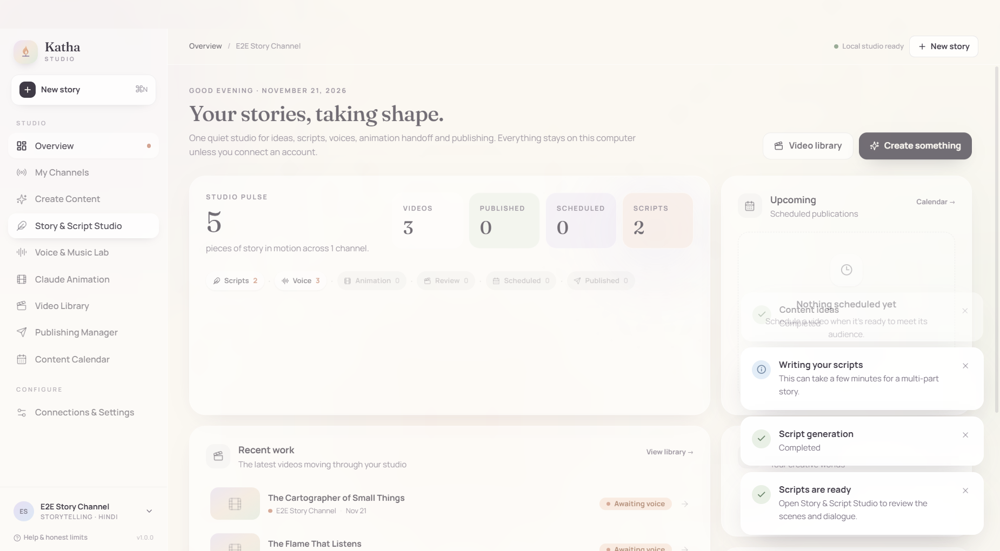

# Katha Studio

Katha Studio is a local-first Windows desktop studio for turning an idea into a finished story film. It brings ideation, research notes, multi-part scripts, character voices, music, a Claude animation handoff, video validation, YouTube publishing and an Instagram manual workflow into one calm, warm interface.

It is a personal production tool, not a SaaS dashboard. Everything is stored on your computer. External services are only used when you connect them with your own accounts and keys.



> Screenshots in this repository use the built-in demo mode and sample data. Demo ideas, scripts and "videos" are fictional examples, clearly labelled **Demo** in the app.

---

## What it does

- **Channels** - create a permanent channel workspace with a reusable `ANIMATION_PROJECT`, brand notes, visual style guide, character bible, audio guide and output folder.
- **Ideation** - generate content ideas from a prompt, links, files or notes with OpenCode Zen or OpenRouter. A fully offline demo mode is available for trying the workflow without an API key.
- **Story & Script Studio** - develop selected ideas into multi-part scripts with scenes, dialogue, speakers, emotion and delivery notes. Edit everything.
- **Voice & Music Lab** - generate one audio file per dialogue line with ElevenLabs, or use the real Windows SAPI fallback. Import and analyse music, and preview it in the app.
- **Claude Animation Studio** - prepare a production package, a master Claude prompt and a folder-based handoff. Katha Studio detects Claude Desktop and Claude Code, opens the right folder, and validates the rendered video when it appears. It never asks for Claude credentials.
- **Video Library** - import finished films by hand or scan channel output folders. Every file is validated with FFprobe, fingerprinted to prevent duplicates, thumbnailed, and linked back to its project when possible.
- **Publishing Manager** - official YouTube OAuth uploads, thumbnails, captions, privacy and scheduling. Instagram is a deliberately manual workflow with captions, notes and reminders.
- **Content Calendar** - see local plans, YouTube-confirmed schedules and Instagram reminders in one month view.
- **Connections & Settings** - keys in Windows Credential Manager, provider model selection from live catalogues, storage paths, backups, job history, logs and diagnostics.

## What it deliberately does not do

- It does not publish to Instagram automatically and never stores an Instagram password.
- It does not drive Claude's UI, inject prompts, or read Claude credentials. The handoff is a real folder plus a master prompt that you open yourself.
- It does not invent YouTube confirmation. A schedule is only marked as confirmed after YouTube accepts it.
- It does not hide failures. Upload, generation and packaging errors are stored on the job or record and shown in the interface.
- It does not bundle API keys, OAuth clients or accounts. You add your own when you want those integrations.

## Requirements

| Component | Requirement |
| --- | --- |
| Operating system | Windows 10 or 11, x64 |
| Node.js | 20 or newer (for source installs and development) |
| Python | 3.11 or newer (for source installs; tested with 3.13) |
| Media tools | FFmpeg and FFprobe. Bundled through npm for source installs and in the installer. |
| Optional accounts | OpenCode Zen or OpenRouter, ElevenLabs, Google/YouTube |

## Install

### Option A - Windows installer

Build the installer once with `npm run dist`, then run:

```text
release\Katha Studio Setup 1.0.0.exe
```

The installer is not code-signed. Windows SmartScreen may show an "Unknown publisher" warning. Choose **More info > Run anyway** only if you built the installer yourself or trust the source.

### Option B - run from source

```powershell
git clone <your-repository-url> social-media
cd social-media
powershell -ExecutionPolicy Bypass -File scripts\setup.ps1
.\start-katha.bat
```

`setup.ps1` installs npm and Python dependencies, creates `backend\.venv`, writes a local `backend\.env`, verifies the bundled FFmpeg tools and creates the workspace. `start-katha.bat` runs setup automatically if it has not been done.

For development with hot reload:

```powershell
.\scripts\start.ps1
```

See [INSTALLATION.md](INSTALLATION.md) for full details, build instructions and uninstall notes.

## First run

1. Create a channel in **My Channels**. This creates its permanent animation project and folders.
2. Open **Create Content**, choose the channel, and either connect an AI provider in **Connections & Settings** or switch on **Offline demo mode**.
3. Generate ideas, select one or two, and write the scripts.
4. Review the script in **Story & Script Studio**, generate voice lines, and approve it.
5. Generate a production package and hand it to Claude from **Claude Animation**.
6. Put the rendered film in the channel output folder. Katha Studio imports it, or you can import it by hand in **Video Library**.
7. Connect YouTube in **Publishing Manager** if you want to upload or schedule. Prepare Instagram posts manually.
8. Use **Content Calendar** to see what is planned and what YouTube has confirmed.

A complete walkthrough is in [USER_GUIDE.md](USER_GUIDE.md).

## Where your work lives

| Data | Default location |
| --- | --- |
| Database, backups, logs, thumbnails | `%LOCALAPPDATA%\Katha Studio` |
| Channels, animation projects, packages, music, outputs | `Documents\Katha Studio` |
| API keys and OAuth tokens | Windows Credential Manager, service `KathaStudio` |

You can move the workspace and individual storage roots in **Connections & Settings > Studio**. Back up from the same screen. The database is SQLite with versioned migrations.

## Accounts and keys

| Integration | What you need | Where it is used |
| --- | --- | --- |
| OpenCode Zen | Zen API key | Ideas, scripts, metadata |
| OpenRouter | OpenRouter API key | Ideas, scripts, metadata |
| ElevenLabs | API key and a voice | Per-line narration |
| YouTube | Google Cloud OAuth client (Desktop app) and a YouTube channel | Uploads, schedules, thumbnails, captions |
| Windows SAPI | Nothing | Offline narration fallback |
| Claude Desktop / Claude Code | Your own Claude installation and account | Animation handoff, outside Katha Studio |
| Instagram | Nothing in Katha Studio | Manual posting from your phone or browser |

Model IDs are never hard-coded as the only choice. Katha Studio loads the live catalogue from the provider after a key is connected and lets you pick a model. A saved default is used when the catalogue cannot be loaded.

## Build and test

```powershell
npm run typecheck        # TypeScript renderer and Electron checks
npm run build            # renderer + Electron production build
npm run build:backend    # PyInstaller backend executable
npm run dist             # build everything and create the NSIS installer
npm test                 # pytest, typecheck and production renderer build
npm run test:e2e         # Playwright Electron tests (builds first)
```

The test suite covers the real local flows: channel creation, demo ideation, script generation, Windows SAPI narration, package generation, FFprobe video import, duplicate prevention, media serving, publications, Instagram manual items, calendar, settings, backups, diagnostics and the packaged app.

What cannot be tested here without your accounts: live Zen/OpenRouter generation, live ElevenLabs synthesis, and real YouTube OAuth/upload. The app reports those states honestly instead of pretending they succeeded.

## Documentation

- [INSTALLATION.md](INSTALLATION.md) - setup, build, installer, first run, uninstall
- [USER_GUIDE.md](USER_GUIDE.md) - every screen and workflow
- [ARCHITECTURE.md](ARCHITECTURE.md) - processes, data model, jobs, security, packaging
- [INTEGRATIONS.md](INTEGRATIONS.md) - Zen, OpenRouter, ElevenLabs, YouTube, Claude, Instagram
- [TROUBLESHOOTING.md](TROUBLESHOOTING.md) - logs, diagnostics, common failures and fixes

## Project structure

```text
backend/
  app/                 FastAPI app, routers, services, models, migrations
  tests/               pytest suite
  run_backend.py       packaged backend entrypoint
electron/              Electron main process and preload bridge
src/                   React renderer (pages, components, store, lib)
e2e/                   Playwright Electron tests
scripts/               setup, start, test and packaging scripts
build/                 app icon and PyInstaller work files
docs/                  screenshots
```

## License

MIT. See the project metadata. Third-party services and assets keep their own terms.
